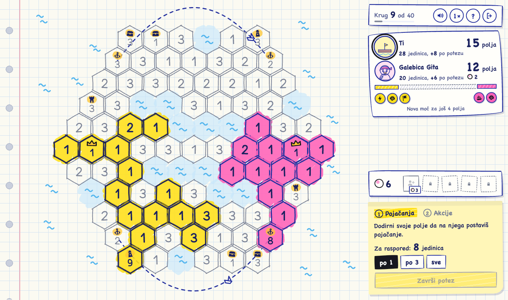
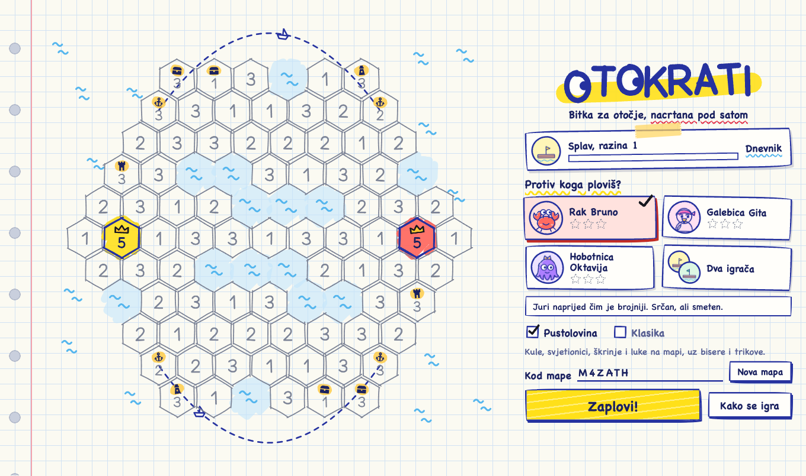
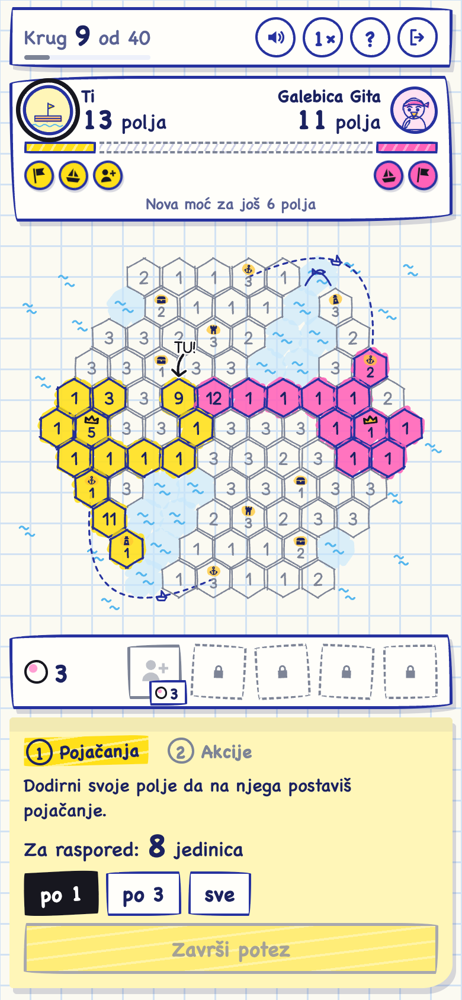

# Otokrati

**Bitka za otočje, nacrtana pod satom.** Potezna igra osvajanja otočja za preglednik, za djecu od 10 do 13 godina.
Cijela igra je jedna HTML datoteka: bez instalacije, bez interneta, bez reklama.

*A turn-based island-conquest game for kids aged 10–13, in Croatian. One HTML file, no install, works offline.*



## Igraj

1. Otvori [index.html](index.html) na GitHubu i klikni **Download raw file** (ili kloniraj repo).
2. Dvaput klikni preuzetu datoteku. Igra se otvara u pregledniku.
3. Odaberi protivnika i klikni **Zaplovi!**

Ništa se ne instalira i ništa ne ide na mrežu. Napredak se sprema u pregledniku, na uređaju na kojem se igra.

## O igri

Otočje je mreža od 91 šesterokutnog polja, nacrtana kao da ju je netko škrabao u bilježnicu na kockice pa je oživjela.
Ti vodiš žutu flotu i kreneš od svoje prijestolnice, a protivnik od svoje, na suprotnoj strani otočja. Polje po polje
osvajaš otočje, skupljaš bisere za trikove i biraš moći koje te prate do kraja partije. Pobjeđuješ kad osvojiš
protivničku prijestolnicu.

Igra je napravljena za djecu koja već dobro čitaju: svaki napad unaprijed pokazuje točnu vjerojatnost pobjede, a ako
igrač oklijeva, strelica „Tu!” predloži razuman potez.

### Potez u tri koraka

1. **Pojačanja.** Dobivaš 2 jedinice i još jednu za svaka tri polja koja držiš, pa ih rasporediš po svojim poljima.
2. **Akcije.** Polje s barem dvije jedinice šalje jedinice susjedu: na svoje polje ih premješta, na tuđe ili ničije
   napada. Polje koje je primilo jedinice miruje do sljedećeg poteza.
3. **Kraj poteza.** Potez se završava sam kad više nemaš što odigrati.

**Borba** se vodi kockom, rundu po rundu: manji broj gubi jedinicu, a izjednačeno dobiva branitelj. Prijestolnica se
brani s +1. **Pobjeđuješ** kad osvojiš protivničku prijestolnicu ili mu ne ostane nijedno polje. Ako nitko ne pobijedi
do 40. kruga, pobjeđuje onaj s više polja.

### Protiv koga ploviš

| Protivnik | Razina | Kako igra |
| --- | --- | --- |
| **Rak Bruno** | lagano | Juri naprijed čim je brojniji. Srčan, ali smeten. |
| **Galebica Gita** | srednje | Važe svaki zalogaj i krade što nije čuvano. |
| **Hobotnica Oktavija** | teško | Osam krakova, osam planova. Misli unaprijed. |
| **Dva igrača** | — | Udvoje na istom uređaju, potez po potez; flote se mogu imenovati. |

### Pustolovina i klasika

**Klasika** su gola pravila iznad. **Pustolovina** (zadano) dodaje:

- **Znamenitosti** u zrcalnim parovima, da nijedna strana nema prednost: kule (+1 u obrani), svjetionici (+1
  pojačanje po potezu), škrinje s biserima i dvije luke spojene morskim putem.
- **Bisere i trikove.** Za svako osvojeno polje dobiješ biser, a biseri se troše na jedan trik po potezu.
- **Moći.** Nakon 3, 7, 12, 18 i 25 osvojenih polja biraš jednu od tri ponuđene moći i zadržavaš je do kraja partije.

<details>
<summary>Trikovi i moći</summary>

| Trik | Cijena | Učinak |
| --- | --- | --- |
| Pojačanje | 3 | 3 nove jedinice na tvoje polje |
| Štit | 2 | polje se brani s +1 do tvog sljedećeg poteza |
| Top | 4 | tuđe polje uz tvoje gubi 2 jedinice (ne probija kule, štitove ni prijestolnice) |
| Sretna kocka | 3 | sljedeći napad u potezu baca s +1 |
| Drugi dah | 2 | polje koje miruje smije opet djelovati |

| Moć | Učinak |
| --- | --- |
| Regruti | +1 pojačanje u svakom potezu |
| Juriš | prvi napad u svakom potezu baca s +1 |
| Bedem | prijestolnica se brani s +2 umjesto +1 |
| Straža | tvoja polja uz prijestolnicu brane se s +1 |
| Školjkar | +1 biser za svako osvojeno polje |
| Cjenkanje | svaki trik stoji biser manje |
| Dvije ruke | 2 trika u potezu |
| Zastava | +1 jedinica na svakom osvojenom polju |
| Zakopano blago | odmah 4 bisera |
| Novi brod | odmah 4 jedinice na prijestolnicu |

</details>

### Napredovanje

Svaka partija donosi iskustvo, a s iskustvom raste i tvoj brod, od splavi do galijuna, kroz sedam razina. Razine redom
otključavaju trikove. Protiv svakog protivnika skupljaš do tri zvjezdice, a u brodskom dnevniku čeka 12 znački.
Protivnici ostaju jednako teški iz partije u partiju, jer moći traju samo jednu partiju.

### Kod mape

Svaka mapa ima kod od šest znakova (npr. `M4ZATH`). Isti kod uvijek daje istu mapu i ista bacanja kocke. Pošalji ga
prijatelju pa vidite tko bolje igra na istom otočju.

<p>
  
  &nbsp;
  
</p>

### Upravljanje

Igra se mišem ili dodirom: dodirni svoje polje, pa susjedno. Na tipkovnici `←` `→` (ili `-` `+`) mijenjaju koliko
jedinica šalješ, `Enter` potvrđuje, `Esc` odustaje, a `M` uključuje i isključuje zvuk. Animacije se mogu ubrzati, a
igra poštuje postavku sustava za smanjeno kretanje.

## Uređaji i preglednici

Igra je izrađena i provjerena u **Chromeu**, na računalu i u rasporedima mobitela, uspravno i položeno. **Firefox i
Safari još nisu isprobani**, kao ni zvuk na pravim uređajima. Ako nešto ne radi, otvori issue.

Napredak je spremljen u `localStorage` preglednika. Vezan je uz taj preglednik i uz adresu s koje se igra otvara, pa
drugi preglednik ili ista igra s web adrese počinju ispočetka. Napredak briše čišćenje podataka preglednika.

## Za razvoj

Treba **Node 22** ili noviji. Ovisnosti nema, pa se ništa ne instalira.

```sh
node --test                                    # 55 testova: pravila, borba, AI, napredovanje, dvoboj, moći
node tools/simulate.js --games 300             # turnir računala protiv računala, obje vrste igre
node tools/simulate.js --games 100 --mode adventure --pairs hard:normal   # jedan par, jedna vrsta igre
```

`pnpm test` i `pnpm simulate` rade isto.

### Kako je igra složena

[index.html](index.html) sadrži stilove, markup i jednu skriptu. Grafika se crta kodom (drhtave linije, šrafure,
rukom pisano pismo), a zvuk se sintetizira u pregledniku, pa nema ni jedne slike, fonta ni biblioteke.

Logika je odvojena od preglednika i radi i u Nodeu. Stanje je nepromjenjivo, a `Rules.applyAction(state, action)`
vraća novo stanje i popis događaja iz kojih sučelje animira. Sva slučajnost dolazi iz generatora sa seedom, pa je
partija potpuno određena kodom mape i potezima.

| # | Modul | Što radi |
| --- | --- | --- |
| 1 | `CONFIG` | sve vrijednosti za podešavanje: mapa, pravila, trikovi, moći, AI, napredovanje, tempo animacija |
| 2 | `Prng` | generator slučajnih brojeva sa seedom |
| 3 | `Hex` | geometrija heksagonalne mreže |
| 4 | `MapGen` | kod mape → otočje sa znamenitostima |
| 5 | `Combat` | kocke i točne vjerojatnosti pobjede |
| 6 | `Rules` | stanje igre i prijelazi |
| 7 | `AI` | tri protivnika kao čiste funkcije stanja |
| 8 | `Career` | iskustvo, razine, zvjezdice, značke |
| 9 | `Lang` | hrvatski oblici uz brojeve |
| 10 | preglednik | crtanje, zvuk, animacije, unos, zasloni |

Moduli 1–9 ne diraju DOM, pa ih testovi i alati učitavaju izravno iz `index.html`
([tools/load-core.js](tools/load-core.js)).

### Alati

| Datoteka | Što radi |
| --- | --- |
| [tools/simulate.js](tools/simulate.js) | turnir po parovima razina, u radnim nitima; svaka mapa se igra dvaput, sa zamijenjenim prvim potezom |
| [tools/arena.js](tools/arena.js) | jedna partija računala protiv računala |
| [tools/browser-autoplay.js](tools/browser-autoplay.js) | odigra cijelu partiju kroz stvarno sučelje i usporedi prikaz s logikom |

`browser-autoplay.js` se pokreće u konzoli preglednika na otvorenoj igri, kao `await (<sadržaj datoteke>)()`. Ako
prije toga postaviš `window.autoplayUntilRound = 12`, partija stane u 12. krugu.

### Koliko su protivnici jaki

Turnir od 300 partija po paru, 22.11.2026.:

| Par | Klasika | Pustolovina |
| --- | --- | --- |
| Gita protiv Brune | 100,0 % | 98,0 % |
| Oktavija protiv Gite | 79,3 % | 91,3 % |
| Oktavija protiv Brune | 97,7 % | 99,7 % |

Klasika je regresijska mjera: nakon izmjene pravila, AI-ja ili `CONFIG`-a njezini postoci moraju ostati isti, jer je
uz iste seedove klasična partija potpuno određena.

## Struktura repoa

```text
index.html        cijela igra
tests/            node --test: rules.test.js (klasika), adventure.test.js (pustolovina, dvoboj, moći)
tools/            turnir, partija računala, provjera kroz preglednik
.github/readme/   snimke zaslona za ovaj README (igra ih ne koristi)
.githooks/        pre-push provjere: git config core.hooksPath .githooks
LICENSE           MIT
```

## Licenca

[MIT](LICENSE): igru smiješ igrati, mijenjati, dijeliti i postaviti na svoju stranicu, i u komercijalne svrhe, uz uvjet
da uz nju ostane napomena o autoru i licenci (vrh `index.html` i datoteka `LICENSE`).
